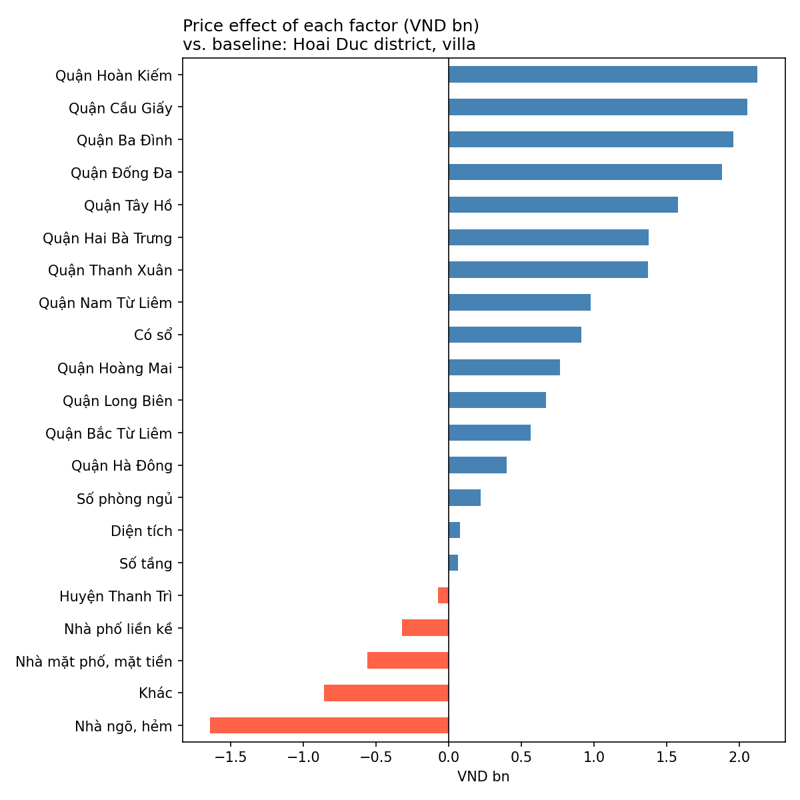
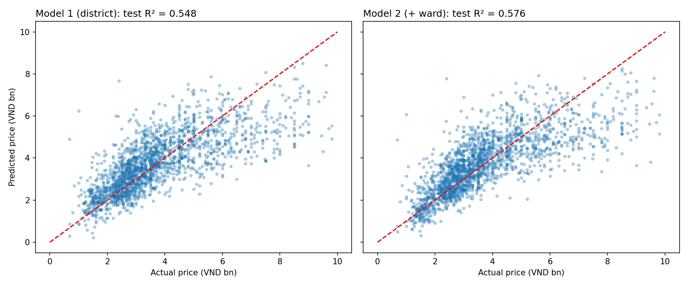

# hanoi-housing-price-regression
Multiple linear regression on 11,294 Hanoi house listings: what drives asking prices and by how much (Python, statsmodels)
# Hanoi Housing Price Drivers – Multiple Linear Regression

**What drives the asking price of a house in Hanoi, and by how much?**
A multiple linear regression on 11,294 house listings (Jul–Aug 2020) to quantify the effect of location, property type, floor area and legal status.

## Key findings

- **Location matters most.** With size and features held equal, a house in Hoan Kiem, Cau Giay or Ba Dinh asks **~VND 2bn more** than one in Hoai Duc.
- **Hoan Kiem overtakes Cau Giay once size is controlled.** Cau Giay has the higher median price (4.55bn vs 3.93bn), but Hoan Kiem houses are smaller (34.5 vs 44 m²). At equal size, Hoan Kiem is the most expensive district.
- **Each extra m² adds ~VND 76m**; a house in an alley is ~VND 1.1bn cheaper than a street-front house; a land-use certificate ("sổ đỏ") adds **~VND 0.9bn**.
- **The model explains ~55–58% of price variation** on unseen data (MAE ≈ VND 0.81–0.85bn). Most of the rest likely sits in information the listings do not hold: alley width, distance to main roads, interior, age.



## Data

 - **Source:** Hanoi house listings (Jul–Aug 2020), provided as self-study material in the Tomorrow Marketers Professional Data Analyst programme – `data/VN_housing_dataset.csv`
- **Scope:** 11,294 listings in Hanoi, 12 columns (district, ward, house type, legal status, floors, bedrooms, area, length, width, price in VND bn)
- **After cleaning:** 9,862 listings (houses ≤ 75 m², price VND 0.5–9.85bn)

**Data quality issues found and handled**
- Prices of 0 and up to VND 100bn → IQR filtering on price and area, plus a floor of VND 0.5bn
- Length/width entered in millimetres for some rows (e.g. "120000 m") → near-zero correlation with price; dropped in favour of floor area
- Districts with < 30 listings (e.g. Soc Son: 3) → grouped as "Other"

## Approach

1. Cleaning: extract numbers from text fields ("4 phòng", "10 m"), drop high-cardinality text columns
2. Outliers: IQR rule on price and area
3. EDA: correlation heatmap, price by district / house type / legal status
4. Encoding: one-hot with `drop_first` (baseline = Hoai Duc, villa); 80/20 train-test split
5. Model 1: OLS with 21 variables (scikit-learn + statsmodels)
6. Diagnostics: VIF, Durbin–Watson, Breusch–Pagan, Jarque–Bera, residual plots
7. Model 2: add ward (115 variables), compare with 5-fold cross-validation

## Results

| | Model 1 (district) | Model 2 (+ ward) |
|---|---|---|
| Variables | 21 | 115 |
| R² train | 0.571 | 0.610 |
| **R² test** | **0.548** | **0.576** |
| MAE (VND bn) | 0.850 | 0.814 |
| 5-fold CV R² | 0.562 ± 0.011 | 0.592 ± 0.010 |

Model 2 wins in all 5 folds, so the gain from ward-level location is stable. Model 1 is kept for interpretation (21 readable coefficients).



## Limitations

- **Asking prices, not transaction prices**, and listing data contains entry errors
- **Heteroscedasticity** (Breusch–Pagan p ≈ 0) and right-skewed residuals; expensive houses (> VND 7bn) are under-predicted by ~2.5bn on average
- **Narrow scope:** houses ≤ 75 m² and ≤ VND 10bn; not apartments or large villas
- **2020 data**, before the 2021–2024 price rise: not suitable for valuing houses today

## Next steps

- Add location features (alley width, distance to centre or main roads via geocoding)
- Try non-linear models (Random Forest, Gradient Boosting) to capture interactions such as area × district
- Use robust (HC3) standard errors for inference

## How to run

Open `hanoi_housing_price_regression.ipynb` in Google Colab or Jupyter. The notebook reads `data/VN_housing_dataset.csv`.

```
pip install pandas numpy matplotlib seaborn scikit-learn statsmodels
```

---
*Tran Bao Phuc · phuctran120116@gmail.com*
